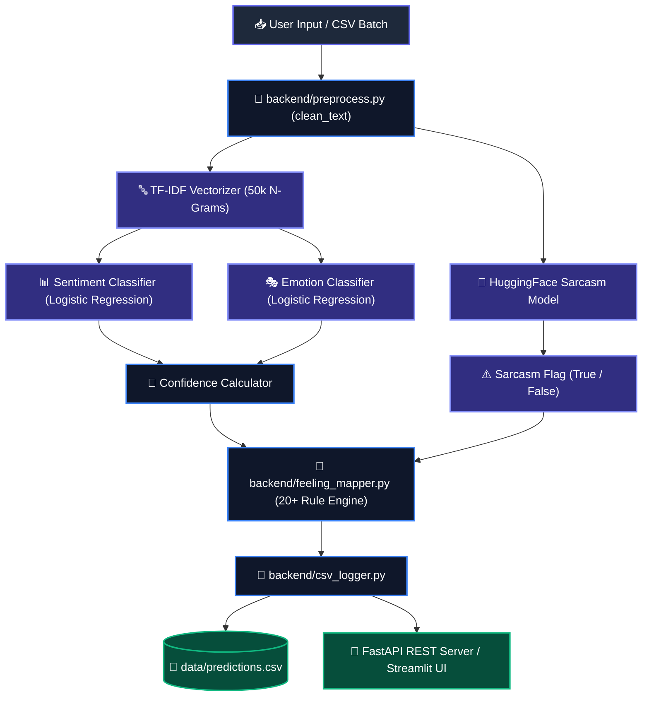

# 🧠 SentimentIQ — Multi-Tiered Affective Intelligence Platform

[](https://www.python.org/downloads/)
[](https://fastapi.tiangolo.com/)
[](https://streamlit.io/)
[](https://github.com/astral-sh/uv)

**SentimentIQ** is an end-to-end Natural Language Processing (NLP) platform that goes beyond basic positive/negative classification. It synthesizes **Sentiment Analysis**, **Emotion Detection**, **Fine-Grained Human Feelings Mapping**, and **Sarcasm/Irony Detection** into a unified, real-time intelligence engine.

---

## 🌟 Key Features

1. **Multi-Tiered Affective Pipeline**:
   - **Sentiment**: Classifies text as `Positive`, `Neutral`, or `Negative` (trained on `cardiffnlp/tweet_eval`).
   - **Emotion**: Identifies core emotional states (`Sadness`, `Joy`, `Love`, `Anger`, `Fear`, `Surprise` trained on `dair-ai/emotion`).
   - **Sarcasm / Irony Detection**: Leverages HuggingFace `helinivan/english-sarcasm-detector` model with fallback rules.
   - **Synthesized Feeling Mapping**: Word-boundary rule engine mapping combinations into 7 human feelings (*Excited, Grateful, Frustrated, Bitter, Anxious, Shocked, Peaceful*).
2. **Production FastAPI Backend**:
   - High-performance REST API supporting single predictions, batch text analysis, historical query logging, and analytics summaries.
3. **Interactive Streamlit Web Dashboard**:
   - Sleek glassmorphic dark theme UI with real-time text analysis, Plotly visual analytics, batch CSV processing, and system architecture docs.
4. **Structured Logging & Persistent CSV Storage**:
   - Centralized logging ([logs/sentimentiq.log](logs/sentimentiq.log)) and auto-incrementing, timestamped prediction persistence with history search, CSV exporting, and clearing.

---

## 🏗️ Architecture & Dataflow



---

## 🛠️ Technology Stack

- **Core Engine**: Python 3.11+, Scikit-Learn 1.8+, Pandas, NumPy
- **Deep Learning / NLP**: HuggingFace Transformers, PyTorch
- **REST API Server**: FastAPI, Uvicorn, Pydantic
- **Web Frontend**: Streamlit, Plotly Express
- **Package Management**: `uv` (Fast, reliable Python package resolver)

---

## 🚀 Quickstart & Installation

### 1. Prerequisites
Ensure you have Python 3.11+ and `uv` installed:
```bash
pip install uv
```

### 2. Environment Setup
Clone the repository and install all dependencies:
```bash
git clone https://github.com/ahmadaquib/SentimentIQ.git
cd SentimentIQ
uv sync
```

### 3. Environment Configuration
Copy `.env.example` to `.env` and set your configuration variables:
```bash
cp .env.example .env
```

Key environment variables in `.env`:
```ini
API_HOST=127.0.0.1
API_PORT=8000
FRONTEND_PORT=8501
SARCASM_MODEL=helinivan/english-sarcasm-detector
LOG_LEVEL=INFO
```

### 4. Unified Application Launch
To launch both the **FastAPI Backend** and **Streamlit Web App** simultaneously:
```bash
uv run python run.py
```

- **Streamlit Web UI**: [http://127.0.0.1:8501](http://127.0.0.1:8501)
- **FastAPI Interactive Docs**: [http://127.0.0.1:8000/docs](http://127.0.0.1:8000/docs)

---

## 📡 REST API Endpoints

| Method | Endpoint | Description |
| :--- | :--- | :--- |
| `POST` | `/predict` | Analyze single text string and log prediction |
| `POST` | `/predict/batch` | Batch analyze list of text strings |
| `GET` | `/history` | Fetch historical predictions from CSV log |
| `GET` | `/analytics` | Retrieve aggregate statistics (counts, confidence, distributions) |
| `DELETE`| `/history` | Clear historical prediction logs |
| `GET` | `/health` | API & model health check status |

### Example Request (`POST /predict`)
```json
{
  "text": "Oh great, another unexpected flight delay, just what I needed today /s"
}
```

### Example Response
```json
{
  "id": 1,
  "timestamp": "2026-08-02T11:00:00.000000",
  "text": "Oh great, another unexpected flight delay, just what I needed today /s",
  "sentiment": "Negative",
  "emotion": "Anger",
  "feeling": "Frustrated",
  "sarcasm": true,
  "confidence": 0.8425
}
```

---

## 📓 Notebook Pipeline Overview

- `00_download_datasets.ipynb`: Downloads sentiment (`tweet_eval`), emotion (`dair-ai/emotion`), and `go_emotions` datasets into `data/raw/`.
- `01_sentiment_exploration.ipynb`: Exploratory Data Analysis (EDA) on sentiment splits.
- `02_emotion_exploration.ipynb`: EDA on emotion categories.
- `03_go_emotions_exploration.ipynb`: EDA and mapping table for 28 fine-grained emotions.
- `04_sentiment_training.ipynb`: TF-IDF vectorizer fitting & sentiment Logistic Regression model training.
- `05_emotion_training.ipynb`: Emotion classifier training reusing the sentiment TF-IDF feature space.
- `06_generate_demo_data.ipynb`: Automated script populating analytics dashboard with demo predictions.

---

## ⚖️ Key Engineering Trade-Offs

1. **Data Leakage Prevention**:
   - The TF-IDF vectorizer was `.fit_transform()`ed **exclusively on the training split** of the sentiment dataset. All subsequent splits and emotion models only call `.transform()`, preventing vocabulary leakage.
2. **The Disgust Gap**:
   - The `dair-ai/emotion` dataset omits a `Disgust` label. To address this gap, the Feeling Mapper synthesizes negative sentiment without anger into `Frustrated` or `Bitter` depending on keyword triggers.
3. **Resilient Offline Inference**:
   - HuggingFace model inference includes a rule-based fallback heuristic if offline or low-bandwidth environments are encountered.

---

## 📄 License
Distributed under the MIT License.
